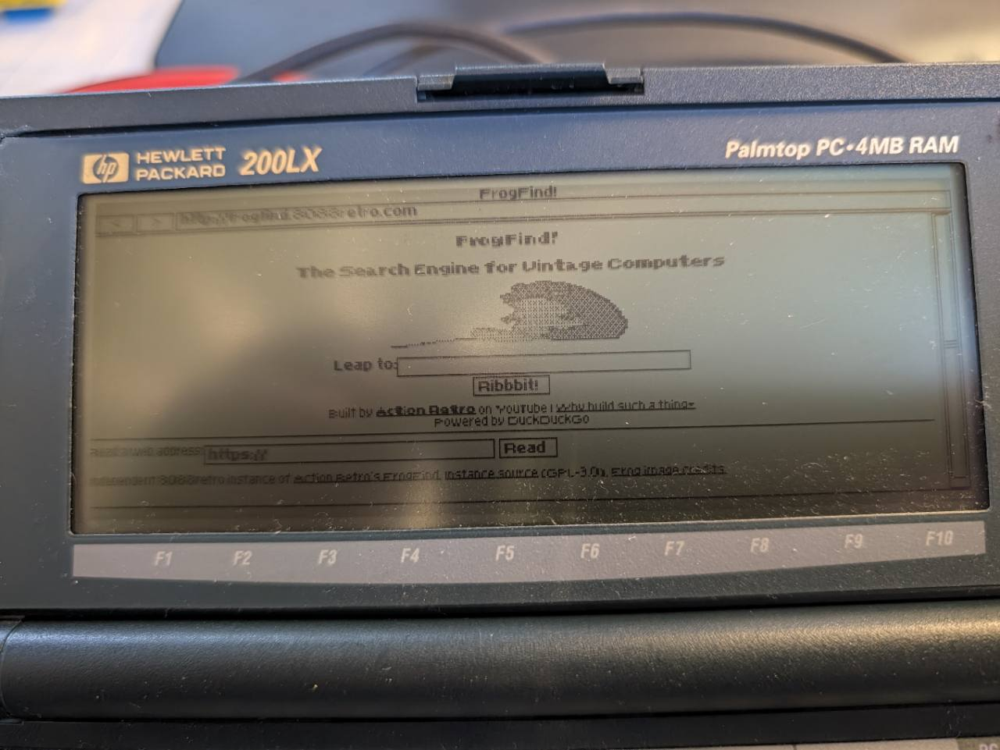
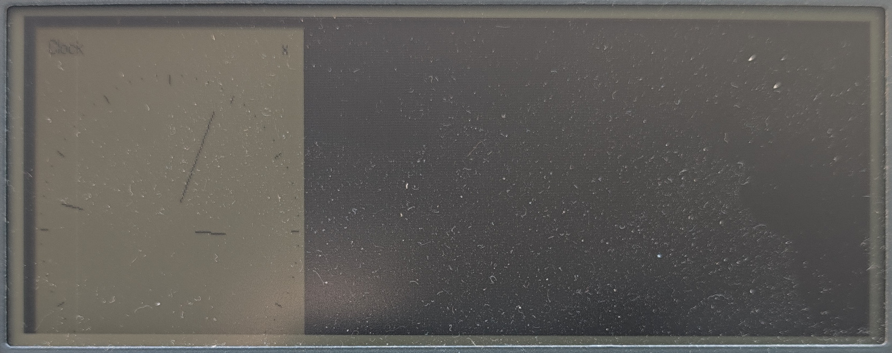

# ELKS on the HP 200LX

**HP 200LX package 4.0 · based on ELKS 0.9.2**

Run [ELKS](https://github.com/ghaerr/elks), a small Linux system for 16-bit x86
computers, on the HP 200LX with its built-in keyboard, native display controls,
persistent storage and graphical HTTP browsing. One DOS launcher selects between
**two kernels**: CF root storage, or an internal filesystem file on C: that leaves
the PCMCIA slot available for an Accton Ethernet card.

[Download 4.0](https://github.com/l00nix/elks-on-hp200lx/releases/tag/hp200lx-release-4.0)
· [Changes since 3.5](docs/hp200lx/RELEASE-4.0.md)
· [Hardware acceptance](docs/hp200lx/ACCEPTANCE-4.0.md)
· [Build/source guide](docs/hp200lx/BUILD-4.0.md)
· [Historical releases](https://github.com/l00nix/elks-on-hp200lx/releases)
· [Pre-4.0 README archive](docs/hp200lx/history/README-before-4.0.md)

**4.0 is the HP integration package version, not an upstream ELKS version.**
Install the complete boot folder at **C:\ELKS4**. The boot banner and `uname -a`
identify `hp200lx-4.0-local` or `hp200lx-4.0-cf`, dated 2026-10-21.
Keep all boot-kit files together; do not mix helpers and kernels from other builds.



*Actual palmtop during Release 4 acceptance: the single-speed unit loaded
FrogFind over the Internet through the Accton card, including the frog GIF.*

## What works

- Factory-speed and double-speed HP 200LX operation; `/DS` selects the display correction.
- BIOS keyboard, zoom, panning, cursor focus and screen inversion.
- A 636 KiB conventional-memory boundary, reserving the top 4 KiB for firmware.
  This is a boundary, not free application RAM; kernel and programs use part of it.
- Writable Minix root on CF (`/dev/cfa1`) or in a DOS C: image (`/dev/ssd`),
  with mapping/storage validation and guarded recovery.
- Guarded CF sleep, including the tested `edit` text-editor case.
- Opt-in writable local sleep at the idle shell, with an empty slot or the
  tested Accton EN2216 R02. See the exact scope below.
- DHCP, DNS and live HTTP browsing using the local kernel, Accton and `ktcp`.
  FrogFind and 68k.news rendered on real hardware; large pages are slow.
- ELKSWeb plus ELXbat, ELXstat, ELX Commander, ELXdash, ELXctl and ELXcap.
- Corrected HP Nano-X applications and `nx` launcher in the CF images.
- Serial shell helper and stock ELKS v0.9.2 raw Minix image compatibility.

## HP BIOS functions and keyboard shortcuts

The HP integration retains native firmware services for the palmtop's keyboard
and display. The keys below use drawings inspired by the HP keyboard legends.
A **+** between keys means hold them together.

| Keys | Function | What to expect |
| --- | --- | --- |
|  | Invert the screen | Swap the light and dark display polarity. Repeat **ON + /** to restore it. |
|  | Change zoom | **Fn + Space** cycles through the firmware's text zoom levels. |
|  | Pan the view | Hold **Menu** and press an arrow to move the visible window over the larger text screen. |
|  | Sleep / wake | Request sleep with **ON/OFF**; wake with **ON**. ELKS checks whether the current activity can be suspended safely. |
|  | Reboot to DOS | **Ctrl + Alt + Del** restarts the palmtop. Save and sync first. |
|  | Hard reset | **Ctrl + Shift + ON** recovers a hung system. At an initialization prompt, press **N** to preserve C:. |


### Sleep modes

| Boot mode | Sleep support in 4.0 |
| --- | --- |
| `/CF` | Guarded local text-console sleep; idle shell and `edit` tested. No extra sleep flag. |
| `/LOCAL C:\NAME.MNX /NONET` | Sleep disabled unless `/SLEEPTEST` is added. |
| `/LOCAL C:\NAME.MNX /NONET /SLEEPTEST` | Writable local root; **empty slot**; idle initial shell only. |
| `/LOCAL C:\NAME.MNX /SLEEPNIC` | Opt-in Accton EN2216 R02 recovery; idle initial shell and idle `ktcp`. Do not add `/NONET`. |

Before sleep, exit graphics/apps and close the serial shell. In local mode,
`edit` deliberately blocks sleep; CF's guarded text-reader policy permits the
tested editor case. Unsupported activity or a card in the empty-slot mode
produces a refusal beep/message. A refusal is expected behaviour, not a request
to bypass a guard. Storage is synced and checked before sleep and after wake.
A recovery-integrity failure stops operation rather than continuing writes.

With `/SLEEPNIC`, leave the Accton inserted and cable connected. The same `ktcp`
process survived repeated sleep/wake cycles, and fresh DNS/HTTP/GIF requests
worked after waking on both speed variants. This does not promise preservation
of active TCP sessions or DHCP leases through arbitrarily long sleeps.
Graphics, serial sessions and general application suspend are outside scope.

## Choose your filesystem

Download the **boot ZIP** plus either a CF ZIP or the local-images ZIP.
The boot kit contains 11 files totalling **185,149 bytes** and generates a kernel
copy of up to **82,384 bytes**. Allow **320 KiB free on C:** for the boot kit,
working copy and allocation slack, in addition to any MNX image.

| Option | Filesystem | PCMCIA slot | DOS command from C:\ELKS4 |
| --- | --- | --- | --- |
| CF root | Whole-card Minix partition | Occupied by CF | `RUNELKS /CF` |
| Local root | Raw Minix file in C:\ | Empty or supported NIC | `RUNELKS /LOCAL C:\ELKS2M.MNX /NONET` |

Add `/DS` for a double-speed machine. Boot from a plain DOS prompt after exiting
System Manager. Retain the tested DSPEED initialization for an accelerated unit,
and unload its resident hook with `DSPEED /R` before starting ELKS.

### CompactFlash installation

The four downloads have identical userland contents. Exact sizes deliberately
leave headroom below nominal card capacities:

| Nominal card | Image inside ZIP | Exact bytes | Filesystem KiB |
| --- | --- | ---: | ---: |
| 8 MB | `ELKS4C08.IMG` | 7,340,032 | 7,136 |
| 16 MB | `ELKS4C16.IMG` | 14,680,064 | 14,304 |
| 32 MB | `ELKS4C32.IMG` | 31,457,280 | 30,688 |
| 64 MB | `ELKS4C64.IMG` | 62,914,560 | 61,408 |

1. Verify the release SHA-256 checksums. Use media at least as large as the exact image.
2. Write the IMG to the **whole CF card**, replacing its contents and partition table.
   Back up any files you need first, and verify the written image afterward.
3. Copy the boot ZIP's `ELKS4` folder to `C:\ELKS4` on the HP.
4. Insert the prepared CF, exit System Manager, then run:

   ```dos
   C:
   CD \ELKS4
   RUNELKS /CF
   ```

   On double-speed hardware, use `RUNELKS /DS /CF`.
5. Confirm `/dev/cfa1` is the mounted root. Keep the root card inserted while ELKS runs.

The CF images include corrected HP Nano-X, the tested ELX utility updates,
ELKSWeb, `nx`, `/root/ser`, and ANSI defaults. The kernel is loaded from C:; the CF image also contains a matching `/linux`
copy. Images display the 4.0 release banner.

The images use Minix V1, 1 KiB blocks and 14-character names. Larger cards keep
unused capacity beyond the image. The included **host-side** `grow_cf.py` can
expand an image or a compatible saved card dump to the 16/32/64 MB profiles.
There is no automatic first-boot or mounted-root expansion. See
[CF image and growth guide](docs/hp200lx/CF-IMAGES-4.0.md).

### Internal C: installation

The names describe the intended model class, not the image size:

| File | Exact bytes | Initial free space inside | Recommended free C: before installation |
| --- | ---: | ---: | ---: |
| `ELKS2M.MNX` | 737,280 (720 KiB) | 94 KiB | 1.1 MiB |
| `ELKS4M.MNX` | 3,145,728 (3 MiB) | 224 KiB | 3.4 MiB |

Check actual free C: capacity. Case labels and DOS conventional-memory totals
alone do not establish installed RAM; storage allocation and existing files
also affect what fits. Free space inside MNX is already part of its file size.

1. Back up an existing MNX before replacing it. Copy the chosen file directly
   to `C:\` and the complete boot directory to `C:\ELKS4`.
2. Start with an empty slot and networking disabled:

   ```dos
   C:
   CD \ELKS4
   RUNELKS /LOCAL C:\ELKS2M.MNX /NONET
   ```

   Substitute `ELKS4M.MNX` for the full image and add `/DS` on accelerated hardware.
   To enable empty-slot local sleep, also add `/SLEEPTEST`.
3. Confirm root is `/dev/ssd`. These files are accessed in place in the internal
   battery-backed RAM disk; they are not copied into conventional application RAM.
4. For Ethernet, return to DOS, insert the Accton and boot without `/NONET`:

   ```dos
   RUNELKS /DS /LOCAL C:\ELKS4M.MNX /SLEEPNIC
   ```

   Omit `/DS` on factory-speed hardware. `/SLEEPNIC` is optional; it enables the
   tested idle-network sleep path.

Both images derive from upstream ELKS v0.9.2, retain its DHCP-capable network
userland, and add ELKSWeb and the ELX tools. The compact edition omits Nano-X,
games and manuals. The full edition retains stock programs; **the corrected HP
Nano-X suite is supplied in the CF images**, not promised for the stock-derived
local image. Both local images retain the tested application payloads and contain
ELXbat 0.1.3 and ELXdash 0.2.0-test3. Install the separate utility update pack for
ELXbat 0.1.4's partial redraw and ELXdash test4's clearer charging lock/labels.
See [ELX tools](docs/hp200lx/ELX-TOOLS-4.0.md).

The loader also accepts the tested upstream **v0.9.2 fd2880-minix.img** as a raw
filesystem: copy it to a DOS 8.3 name such as `C:\FD2880.IMG`, then use
`RUNELKS /LOCAL C:\FD2880.IMG`. The loader uses the HP kernel, not the floppy
boot sector or `/linux`. Stock images do not include ELKSWeb or `/root/ser`.
Other image versions and filesystem formats require separate validation.

### Networking

The qualified card is the **Accton EN2216 R02**, using the NE2000 path.
Buffalo, Netgear and other cards are not covered by Release 4 hardware acceptance.
CF-root mode does not provide Ethernet; picoPCMCIA/DualSlot support is future work.
Do not hot-plug a NIC or root CF while ELKS is running.

On the supplied local images, start client networking once:

```sh
ktcp -b -p ne0
netstat
web http://frogfind.8088retro.com/
```

With no static addresses, this `ktcp` requests DHCP. Alternatively, `net start ne0`
uses `/etc/net.cfg`, including its default server-daemon list. For sleep testing,
use only `ktcp` and the idle shell; extra daemons can block the sleep guard.
Do not start a second `ktcp` if one is already running. Static configuration
belongs in `/etc/net.cfg` and DNS configuration in `/etc/resolv.conf`.

The stock server daemons can report `SO_NOBUFFER: Invalid argument` with the HP
kernel. These server features are not qualified; that message does not invalidate
a successful DHCP/client HTTP test. The direct `ktcp` command avoids starting them.

ELKSWeb supports **HTTP**, not native HTTPS. `68k.news` rendered successfully,
but its roughly 92 KB page can take a long time to parse/layout and leaves very
little cache headroom on a nearly full compact filesystem. Start with FrogFind.
Navigation and forms have narrower test coverage than page loading/rendering.

## Everyday use

Run `meminfo`, `df` and `ps` to inspect the system. Use `export TERM=ansi` if an
image has not already set it. The firmware warning and cached voltage readings
are not estimates of remaining battery runtime.

| Tool | Start / basic controls |
| --- | --- |
| ELKSWeb | `web` for welcome page; `web http://frogfind.8088retro.com/`; Tab selects links, Enter opens, F6 or Ctrl+L focuses address. |
| ELXbat | `elxbat`; R rereads cached voltage, Q/Esc exits. Updated build redraws changed regions. |
| ELXstat | `elxstat` or `elxstat -v` for firmware/system information. |
| ELX Commander | `elxcmd /root /tmp`; Tab panels, arrows selection, V view, C copy, M move, D delete, N new directory, Q back/exit. |
| ELXdash | `elxdash`; Tab controls, Left/Right adjust, B battery menu, arrows select, Enter chooses, Esc closes. |
| ELXctl | `elxctl status`, `elxctl --help`; command-line display/sound/firmware settings. |
| ELXcap | `elxcap /root/SCREEN.BMP`; manual or delayed BMP/PBM capture. Alt+period hotkey hook is **not included**. |

See [tool instructions and update procedure](docs/hp200lx/ELX-TOOLS-4.0.md).
Charging controls remain experimental and locked unless `elxdash --charge-test`
is explicitly used. Release 4 acceptance does not certify NiCd charging.

On CF, use `nx`, `nx nxclock`, or `nx nxjpeg /root/earth.jpg`. JPEG rendering can
be slow. ELKSWeb and the ELX tools use their own graphics paths and do not need Nano-X.



*Development photograph; exact build and speed of this capture were not recorded.*

### Serial shell

On the palmtop, run `sh /root/ser`. For an unmodified stock image:

```sh
stty sane 9600 < /dev/ttyS0
/bin/sh < /dev/ttyS0 > /dev/ttyS0 2>&1
```

Connect the peer at **9600 baud, 8N1**. Type `exit` from the peer to release the
serial shell before sleep. Local Ctrl+C did not reliably release the redirected
shell on every tested image; do not depend on it as the serial-exit method.

### Shutdown and reset

Exit applications and use `shutdown -r` to sync/unmount and reboot into DOS.
Do not move or replace an MNX file while ELKS is using it. A hard reset is a last
resort: unsaved data and pending writes can be lost. If the HP asks whether to
initialize after a reset, press **N** to preserve the internal C: drive.

## Validation and limits

The maintainer accepted the hardware tests and sleep guards on 21 October 2026.
The test record distinguishes user observations from serial-verified checks:
[acceptance summary](docs/hp200lx/ACCEPTANCE-4.0.md).
The binaries passed 39 discovered software checks with no skips, and release
packaging verifies every file against its manifest. The naming refresh changes
version displays, boot names and image documentation; application payloads and
filesystem geometry are unchanged.

CF growth beyond 32 MiB has host-side allocation/readback/fsck coverage; this is
not a claim that every CF capacity/card combination or every high-zone workload
was tested physically. Both post-test MNX copies passed forced read-only offline
filesystem checks; their clean flags were unset, with no structural errors found.
No repair or clean-flag rewrite was performed.

Source and licenses are supplied with the release. The matching build source is
in **hp200lx-4.0-source.tar.gz**; follow its release build guide rather than the
historical repository-root build instructions. Historical source and test records retain their original build identities.

## Credits and related projects

Thanks to the [ELKS authors](https://github.com/ghaerr/elks), Greg Haerr,
Richard L. Dubs for HP PCMCIA/BIOS work, Mack Baggette for the HP MINIX firmware
approach, and Stefan Peichl for DSPEED and SLEEPON. Thanks to YYZKevin for
[COMrade](https://github.com/yyzkevin/COMrade), used for hardware development.
See also [ELKSWeb](https://github.com/l00nix/ELKSWeb) and
[MINIX 2 on HP 200LX](https://github.com/l00nix/minix-2-hp200lx).

GEMCAP/CAPLX, CXCTL, ABC/LX and Norton Commander informed utility workflows and
interface ideas. The ELX tools are independent implementations; their original
component/font notices remain in the source and image license files. No HP ROM
or proprietary DOS runtime is distributed. DOS LXdash is a separate project.
